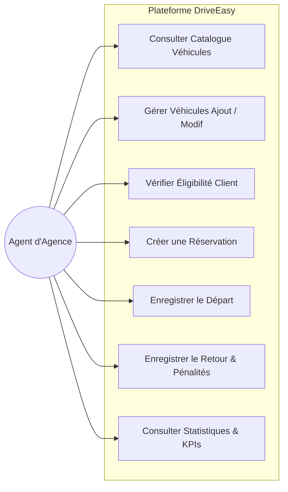
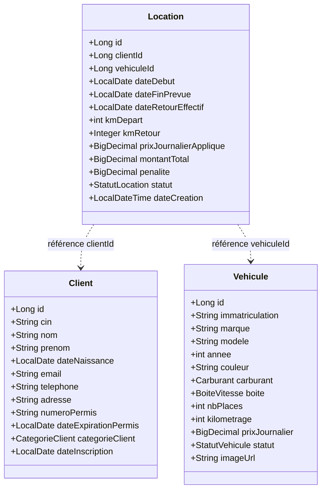
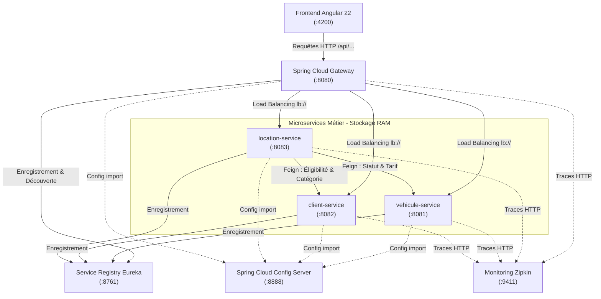

# RAPPORT DE PROJET — ARCHITECTURE MICROSERVICES & ANGULAR

---

# REPUBLIQUE TUNISIENNE
## UNIVERSITE SESAME
### LICENCE EN INFORMATIQUE ET MULTIMEDIA — LIM3 B/C
**Module : Développement d'applications web et multimédia (J2EE, .NET)**

 

# RAPPORT DE PROJET
## THÈME : Conception et Réalisation de la Plateforme de Location de Véhicules « DriveEasy »

 

**Enseignant :** M. Karim Ben Romdhane  
**Année Universitaire :** 2026 – 2027  
**Validation :** Novembre 2026  

---

## Sommaire

1. **Introduction & Contexte Général**
   1.1 Contexte du projet  
   1.2 Problématique de l'ancien système monolithique  
   1.3 Objectifs métier et pédagogiques  
   1.4 Périmètre fonctionnel  
2. **Analyse & Conception du Système**
   2.1 Identification des acteurs  
   2.2 Besoins fonctionnels & non-fonctionnels  
   2.3 Diagramme de Cas d'Utilisation global  
   2.4 Modélisation & Diagrammes de Classes par Microservice  
   2.5 Justification des choix techniques  
3. **Architecture Globale du Système Distribué**
   3.1 Schéma synoptique de l'architecture cible  
   3.2 Rôle et responsabilités de chaque composant  
   3.3 Matrice des ports et protocoles  
   3.4 Flux de communication inter-services et résilience  
4. **Réalisation Technique — Partie Backend (Spring Cloud & Java 21)**
   4.1 Service Registry (Eureka Server - Port 8761)  
   4.2 Serveur de Configuration (Spring Cloud Config - Port 8888)  
   4.3 Microservice Véhicules (`vehicule-service` - Port 8081)  
   4.4 Microservice Clients (`client-service` - Port 8082)  
   4.5 Microservice Locations (`location-service` - Port 8083)  
   4.6 API Gateway (Spring Cloud Gateway - Port 8080)  
   4.7 Observabilité & Traçage Distribué (Zipkin - Port 9411)  
   4.8 Déploiement & Conteneurisation (Docker Compose)  
5. **Réalisation Technique — Partie Frontend (Bonus Angular 22)**
   5.1 Architecture applicative & composants Standalone  
   5.2 Arborescence des dossiers & Service API unique  
   5.3 Description et captures des interfaces utilisateur (UI)  
6. **Conclusion & Perspectives**
   6.1 Bilan des objectifs atteints  
   6.2 Limites actuelles du prototype  
   6.3 Axes d'amélioration futurs  
7. **Annexes**
   7.1 Liens des dépôts GitHub  
   7.2 Webographie & Références officielles  

---

## 1. Introduction & Contexte Général

### 1.1 Contexte du projet
La société **DriveEasy** est une entreprise spécialisée dans la location de véhicules de tourisme et utilitaires pour de courtes et moyennes durées. Afin d'accompagner sa croissance et d'ouvrir de nouvelles agences régionales, la direction a souhaité refondre son système d'information.

### 1.2 Problématique de l'ancien système monolithique
L'ancienne application reposait sur une architecture monolithique vieillissante :
* **Goulot d'étranglement de scalabilité** : impossible d'adapter les ressources serveur indépendamment selon la charge des modules (par exemple, le catalogue très consulté par rapport aux validations de retour).
* **Indisponibilité globale** : une panne sur le module de facturation rendait l'intégralité du système inutilisable.
* **Complexité de maintenance** : couplage fort entre les couches logiques et rigidité des déploiements.

### 1.3 Objectifs métier et pédagogiques
* **Objectifs métier** :
  1. Gérer le parc de véhicules (caractéristiques, kilométrage, statuts `DISPONIBLE`, `LOUE`, `MAINTENANCE`).
  2. Gérer la clientèle et la conformité légale (âge légal ≥ 21 ans, permis de conduire non expiré).
  3. Gérer le cycle de vie complet des locations (réservation, départ en agence, retour avec calcul automatique des pénalités de retard).
  4. Calculer automatiquement les remises de fidélité selon les profils (`STANDARD`, `FIDELE` -5%, `VIP` -10%).
  5. Fournir un tableau de bord décisionnel (chiffre d'affaires, taux d'occupation, véhicules les plus loués).
* **Objectifs pédagogiques** :
  1. Maîtriser l'écosystème **Spring Cloud** (Eureka, Config Server, Gateway, OpenFeign).
  2. Implémenter le stockage strict en mémoire vive (RAM) avec structures thread-safe sans base de données.
  3. Assurer l'observabilité distribuée via **Zipkin** et **Micrometer Tracing**.
  4. Développer une interface moderne avec **Angular 22** consommant exclusivement l'API Gateway.

---

## 2. Analyse & Conception du Système

### 2.1 Identification des acteurs
* **Agent d'Agence (Opérateur)** : consulte les disponibilités, enregistre les départs de véhicules, valide les retours avec saisie kilométrique.
* **Responsable d'Agence (Manager)** : supervise les indicateurs du tableau de bord, le taux d'occupation et le chiffre d'affaires.
* **Système / Orchestrateur de Microservices** : gère les échanges inter-services synchrones et met à jour automatiquement les catégories de fidélité.

### 2.2 Besoins fonctionnels et non-fonctionnels

#### Besoins Fonctionnels
* **Gestion du Parc** : ajout, modification, filtrage par carburant, catégorie, statut et prix max, blocage de suppression si véhicule loué.
* **Gestion Client** : unicité stricte de l'immatriculation, du CIN, de l'email et du numéro de permis (codes HTTP 409).
* **Contrôle d'Éligibilité** : vérification préalable avant toute réservation (âge ≥ 21 ans et permis valide).
* **Calcul Tarifaire Automatisé** :
  $$\text{Prix Total} = (\text{Nombre de Jours} \times \text{Prix Journalier}) \times (1 - \text{Remise}) + \text{Pénalités}$$
  $$\text{Pénalité de Retard} = 1.5 \times \text{Prix Journalier} \times \text{Jours de Retard}$$

#### Besoins Non-Fonctionnels
* **Performance & Concurrence** : utilisation de `ConcurrentHashMap` et `AtomicLong` pour le stockage en RAM.
* **Tolérance aux pannes** : isolation des microservices et gestion centralisée des exceptions (`@RestControllerAdvice`).
* **Sécurité & CORS** : contrôle des origines autorisées depuis l'API Gateway (`http://localhost:4200`).

### 2.3 Diagramme de Cas d'Utilisation

### 2.4 Modélisation des Entités

---

## 3. Architecture Globale du Système Distribué

### 3.1 Schéma Synoptique

### 3.2 Matrice des Ports & Composants

| Composant | Port | Type | Endpoint Actuator |
| :--- | :---: | :---: | :---: |
| **Eureka Server** | 8761 | Registry | `http://localhost:8761/actuator/health` |
| **Config Server** | 8888 | Configuration | `http://localhost:8888/actuator/health` |
| **API Gateway** | 8080 | Gateway / Routage | `http://localhost:8080/actuator/health` |
| **Vehicule Service** | 8081 | Microservice Métier | `http://localhost:8081/actuator/health` |
| **Client Service** | 8082 | Microservice Métier | `http://localhost:8082/actuator/health` |
| **Location Service** | 8083 | Microservice Métier | `http://localhost:8083/actuator/health` |
| **Zipkin** | 9411 | Observabilité | `http://localhost:9411/api/v2/services` |
| **Frontend Angular**| 4200 | Client Web (Bonus)| `http://localhost:4200/dashboard` |

---

## 4. Réalisation Technique Backend

### 4.1 Service Registry (Eureka Server - 8761)
* **Classe principale** : `@EnableEurekaServer`
* **Configuration** : `register-with-eureka: false`, `fetch-registry: false` (conformité section 4.1).
* **Mode développement** : `enable-self-preservation: false` pour désenregistrer immédiatement les instances arrêtées.

### 4.2 Serveur de Configuration (Config Server - 8888)
* **Classe principale** : `@EnableConfigServer`, `@EnableDiscoveryClient`
* **Stockage des configurations** : fiches dédiées pour chaque microservice (`vehicule-service.yml`, `client-service.yml`, `location-service.yml`, `api-gateway.yml`).
* Externalisation des paramètres : ports, adresses Eureka, paramètres d'échantillonnage Zipkin (1.0), pourcentages de remises fidélité.

### 4.3 Microservices Métier & Stockage en RAM
Conformément à l'interdiction stricte de base de données (section 4.3), l'architecture en couches repose sur des dépôts en RAM :
* `VehiculeRepository` : `ConcurrentHashMap<Long, Vehicule>` avec `AtomicLong`.
* `ClientRepository` : `ConcurrentHashMap<Long, Client>` avec recherche d'unicité par CIN, email et numéro de permis.
* `LocationRepository` : `ConcurrentHashMap<Long, Location>` avec indexation des locations par client et véhicule.
* `DataInitializer` : chaque microservice charge automatiquement au démarrage un jeu complet de données de test représentatif.

### 4.4 Communication Inter-Services & Feign
Le service `location-service` orchestre les appels via **Spring Cloud OpenFeign** :
* `ClientServiceClient` : vérifie `checkEligibilite(clientId)` et met à jour `updateCategorie(clientId, category)`.
* `VehiculeServiceClient` : contrôle la disponibilité et applique `updateStatut(vehiculeId, statut)` lors du départ et du retour.

### 4.5 API Gateway & Filtre Personnalisé (Bonus Barème)
La passerelle implémente :
1. Routage dynamique basé sur Eureka (`lb://vehicule-service`, `lb://client-service`, `lb://location-service`) avec filtre `StripPrefix=1`.
2. Support du **CORS** pour l'origine Angular (`http://localhost:4200`).
3. **Filtre Personnalisé (`RequestLoggingGatewayFilter`)** : mesure le temps d'exécution en millisecondes et injecte les en-têtes `X-Response-Time-Millis` et `X-DriveEasy-Gateway-Timestamp`.

### 4.6 Monitoring & Traçage Distribué (Zipkin)
Tous les services embarquent les dépendances `micrometer-tracing-bridge-brave` et `zipkin-reporter-brave`.
Le taux d'échantillonnage est configuré à 1.0 (100%), permettant de visualiser dans l'interface Zipkin (`http://localhost:9411`) la propagation du `TraceId` lors d'une réservation traversant Gateway -> Location Service -> Client Service -> Vehicule Service.

---

## 5. Réalisation Frontend (Bonus Angular 22)

L'application frontend est développée en **Angular avec des composants Standalone** :
* **Routing** : toutes les routes demandées dans le tableau de la section 6.2 sont implémentées (`/dashboard`, `/vehicules`, `/vehicules/new`, `/clients`, `/clients/:id`, `/locations/new`, `/locations`, `/locations/:id/retour`).
* **Formulaires réactifs** : validation complète des champs (immatriculation, prix, dates, kilométrage).
* **Assistant de location (Stepper)** : assistant pas-à-pas guidant l'utilisateur de la sélection du client éligible jusqu'au devis et confirmation.
* **Écran de retour & Impression** : génération d'un récapitulatif avec calcul automatique des pénalités de retard et vue imprimable.

---

## 6. Conclusion & Perspectives

Le projet **DriveEasy** démontre avec succès la transition d'un monolithe vers une architecture distribuée résiliente et évolutive :
* **Points forts** :
  * Découplage complet des services métier.
  * Respect strict du stockage en RAM imposé.
  * Observabilité totale grâce à Zipkin et Actuator.
  * Expérience utilisateur fluide via l'API Gateway et le frontend Angular.
* **Perspectives d'amélioration** :
  * Mise en place d'un Circuit Breaker (Resilience4j) avec mécanismes de repli (fallback).
  * Sécurisation des endpoints via OAuth2 / Keycloak et JWT.

---

## 7. Annexes

* **Dépôt GitHub Backend** : `https://github.com/votre-compte/driveeasy-backend`
* **Dépôt GitHub Frontend** : `https://github.com/votre-compte/driveeasy-frontend`
* **Documentation Spring Cloud** : https://spring.io/projects/spring-cloud
* **Documentation OpenZipkin** : https://zipkin.io/
